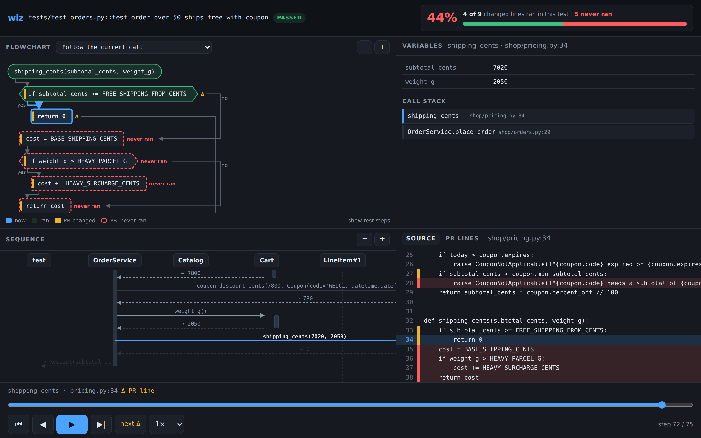
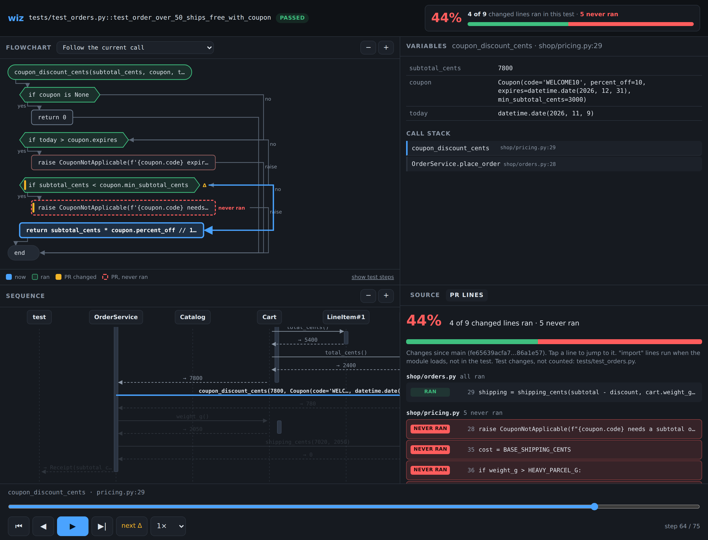
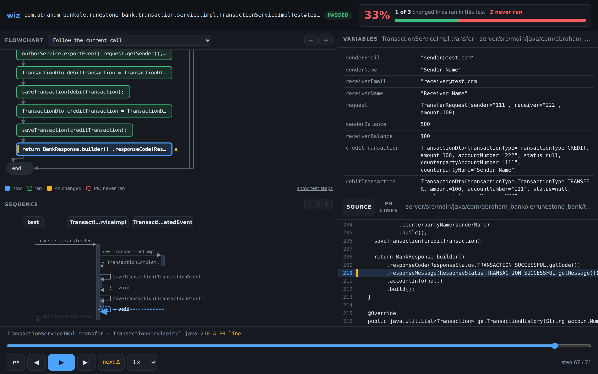

# wizualizer

Step through the code a PR changes, from its tests: flowchart, variables,
sequence diagram, and which changed lines the test actually ran.

`wiz run` runs **one test** (Python with pytest, or Java with JUnit through
Maven or Gradle) under a recorder, writes what the code did step by
step to `trace.json`, and turns it into **one self-contained HTML file** you
open in any browser. Fully local: no network calls, no CDN, no telemetry (the
HTML even sets a Content-Security-Policy that blocks all network access).



What you get: the code under test. The test only drives it, so its own lines
are hidden: the viewer opens on the **function under test** (the first
function the PR changed that the test reaches, else the first one the test
calls), and the test is a single `test` actor in the sequence diagram.
"show test steps" under the flowchart (or `wiz run --test-steps`) brings the
test's own steps back.

- **Flowchart** of the function being run (follows calls, or pin one), with the
  current step lit, the path taken so far, PR-changed nodes striped, and
  changed nodes the test never reached outlined in red.
- **Variables** of the current frame: values at this step, what just changed
  (old value struck through), the call stack.
- **Sequence diagram** of calls and returns between objects and modules.
- **Source** with the current line and the PR's changed lines.
- **PR lines**: changed-line coverage. Which lines the PR changed ran in this
  test, and which never ran. Shown as a headline number at the top too.
- Play / pause / step / scrub / speed, "next Δ" to jump to the next changed
  line that runs. Keys: space, ← →, Home/End, `n`.
- Works on a phone: views become tabs (flowchart first), controls stick to the
  bottom with big tap targets, diagrams scroll inside their box and have zoom
  buttons.



## Install

Needs Python 3.12+ (the recorder uses `sys.monitoring`) and git. For Java: a
JDK (17+; `javac` on PATH, `$JAVA_HOME` or `--java-home`) and the project's
Maven or Gradle (wrappers preferred).

```sh
python3 -m venv .venv
.venv/bin/pip install -e '.[dev]'
```

No runtime dependencies. `pytest` is a dev dependency here; the project you
record needs its own pytest. Java support adds no dependency either: its small
helper (`src/wizualizer/java/helper/`) uses only what every JDK ships, the
debugger API (`jdk.jdi`) and javac's own parser (`jdk.compiler`). It is
compiled once per JDK into `~/.cache/wizualizer/java-helper/`.

## Demo (one command)

```sh
./examples/demo.sh
```

It builds a throwaway git repo in `.wiz/demo-shop` from `examples/shop` (a
small order-pricing service): `main` is the code before the PR, branch
`free-shipping` applies `examples/shop-pr.patch` (free shipping over $50, a
heavy-parcel surcharge, coupon minimum spend). Then it records
`tests/test_orders.py::test_order_over_50_ships_free_with_coupon` and prints
the HTML path. Expect `4 ran, 5 never ran`: the test never takes the paid
shipping path or the coupon-minimum rejection, which is exactly what a
reviewer should notice.

Java version (Maven): `./examples/java-demo.sh` does the same with
`examples/java-shop` and `shop.OrderServiceTest#orderOver50ShipsFreeWithCoupon`.
Same result: `4 ran, 5 never ran` (plus 3 static constants that run at class
load). The first run lets Maven download JUnit and its plugins.

## Use it on a real repo

```sh
cd ~/work/some-service                     # your checkout, on the PR branch
/path/to/wizualizer/.venv/bin/wiz run tests/test_billing.py::test_refund --base main
# → .wiz/tests_test_billing.py__test_refund.html (+ .json)
```

- `--base REF`: changed lines are everything since `git merge-base REF HEAD`,
  including uncommitted and untracked files. Leave it out to skip PR marking.
- `--python PATH`: interpreter to run pytest with. Default: the project's
  `.venv/bin/python` (or `venv/`), else the one running `wiz`. It must be 3.12+
  and have pytest; wizualizer itself does not need to be installed there.
- `--test-steps`: open the viewer with the test's own steps shown. They are
  always recorded; the viewer's "show test steps" toggles them either way.
- `--max-steps N` (default 10000): recording stops there and the viewer says
  "truncated".
- `--out DIR` (default `.wiz`). Add `.wiz/` to your `.gitignore`.
- A node id that matches several tests (a file, a parametrized test) records
  the first one only.

### Java (Maven or Gradle)

```sh
cd ~/work/some-bank                       # anywhere in the git repo, on the PR branch
wiz run com.acme.bank.TransferServiceTest#movesMoney --base main
```

- The test is `Class#method`: full name, simple name if unique, or a path to
  the `.java` file. Nested classes: `OuterTest$Inner#method`.
- The build is found from the test file: the nearest `pom.xml` or
  `build.gradle(.kts)` is its module, the build root is above it (the
  `settings.gradle` or top `pom.xml`). `gradlew`/`mvnw` are used when present,
  else `gradle`/`mvn` from PATH. Only that module's tests run (`-pl module -am`
  for Maven, `:module:test` for Gradle).
- It runs only that test, with `-agentlib:jdwp` added to the test JVM (Maven:
  `-Dmaven.surefire.debug`; Gradle: a temporary init script, build scans off
  with `--no-scan`). The outcome comes from the JUnit XML report.



Proven on [RuneStone-Bank](https://github.com/Semilore317/RuneStone-Bank)
(Spring Boot, Gradle in `server/`): with the repo at commit `fde9dbc`
("return correct success response metadata") and `--base fde9dbc^`,
`TransactionServiceImplTest#testTransfer_Success` records 91 steps in about 7
seconds; 1 of the 3 changed lines ran (the transfer fix); the 2 in
`creditAccount` never ran, as expected. `#testCreditAccount_Success` shows the
reverse (2 of 3).

What gets recorded (Java): methods whose source is in the project. JDK,
libraries, JUnit, Mockito mocks and generated code (Lombok, record accessors,
default constructors) are skipped like library code. Lambdas are folded into
the method that contains them. Variables are the locals plus `this.<field>`
for every field of `this`. Objects from the project show their fields; JDK
collections and maps their items; `BigDecimal`, `java.time` and `UUID` their
value; other library objects their class name. The recorder only invokes JDK
methods (`toArray`, `toString` of those value types), never project code.

### What counts as test code

Test files: `test_*.py`, `*_test.py`, `conftest.py`, `*Test.java`,
`*Tests.java`, `*IT.java`, and anything under a `tests/` or `test/` folder
(so all of Maven/Gradle's `src/test/**`). Every function in them, plus the
test function itself wherever it lives, is test code: recorded but hidden in
the viewer by default, and changed lines in test files are listed as "test
changes" outside the coverage number.

### Python

What gets recorded: code under the git root, minus virtualenvs and
site-packages. Only the test call phase is traced;
fixtures are not.

## Limits

- Python and Java. TypeScript is planned: [docs/next-languages.md](docs/next-languages.md).
- Java: only the test method runs under the recorder (`@BeforeEach` and the
  test class constructor are not recorded) and only on the test's thread.
  Kotlin, Scala and Groovy code are not recorded, nor classes in the default
  package. Classes need debug info (`-g`, Maven and Gradle's default). A
  Surefire `forkCount=0` (tests inside Maven's JVM) is not supported.
  Recording uses breakpoints on every project line plus method entry/exit
  events, so a test runs several times slower than normal.
- Values are rendered strings, bounded (depth 3, 8 items, 240 chars). Objects
  with a custom `__repr__` are shown with it, so a slow or side-effecting
  `__repr__` runs during recording.
- Main thread only. Threads, subprocesses and async tasks running on other
  threads are not recorded.
- Comprehensions, generator expressions and lambdas are folded into their
  enclosing function.
- Flowcharts are approximate around `try`/`finally` (a `return` inside `try`
  is drawn straight to the end) and treat `match` cases as a chain of checks.
- Coverage judges statements, not branches: `x = a if c else b` counts as run
  either way. Module- and class-level lines are "import-time" and not judged.
- Memory (heap) view is not built yet: [docs/memory-view.md](docs/memory-view.md).

## How it fits together

```
test ──▶ Recorder ──▶ recording ──▶ make_trace() ──▶ trace.json ──▶ viewer (HTML)
                                     ▲     ▲
                         SourceModel ┘     └ git diff --base
```

- `src/wizualizer/ports.py`: the Recorder and SourceModel interfaces.
- `src/wizualizer/java/`: Maven/Gradle detection, the JDI recorder adapter,
  the flowchart builder, and `helper/` (the Java side: JDI recorder and the
  javac-based outline of statements and methods).
- `src/wizualizer/python/`: sys.monitoring tracer + pytest plugin (stdlib only,
  loaded into the project's own interpreter), AST statement map and flowchart
  builder.
- `src/wizualizer/diff.py`, `change_coverage.py`, `trace.py`: language-neutral.
- `src/wizualizer/viewer/`: the HTML/CSS/JS, inlined by `render.py`.
- Trace format: [docs/trace-format.md](docs/trace-format.md).

## Development

```sh
.venv/bin/pytest            # unit + integration tests (Java ones skip without a JDK and Maven;
                            # the Gradle one also needs gradle on PATH or a wrapper download)
node scripts/screenshots.js # re-render docs/screenshots (needs Playwright)
node scripts/screenshots.js java <runestone .wiz/…html>  # the java-*.png ones
```
