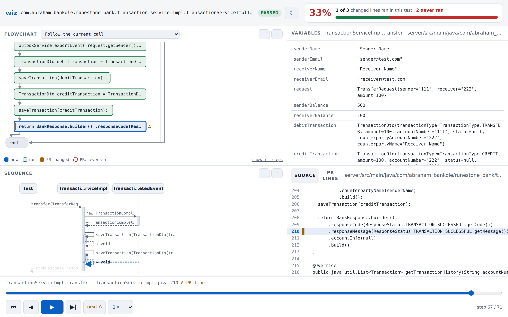

# Java (Maven and Gradle)

Needs a JDK 17+ (`javac` on PATH, `$JAVA_HOME` or `--java-home`) and the
project's Maven or Gradle (wrappers `mvnw`/`gradlew` are preferred).

## How a test is run

- Tests are found by reading the test sources for JUnit 4/5 annotations
  (`@Test`, `@ParameterizedTest`, `@RepeatedTest`, `@TestFactory`,
  `@TestTemplate`), so the list appears without a build.
- The build is found from the test file: the nearest `pom.xml` or
  `build.gradle(.kts)` is its module, the build root is above it (the
  `settings.gradle` or top `pom.xml`). Only that module's tests run
  (`-pl module -am` for Maven, `:module:test` for Gradle).
- It runs only that test, with `-agentlib:jdwp` added to the test JVM (Maven:
  `-Dmaven.surefire.debug`; Gradle: a temporary init script, build scans off
  with `--no-scan`). The outcome comes from the JUnit XML report.
- The first run lets Maven/Gradle download what the project needs, as a normal
  build would.

## What gets recorded

Methods whose source is in the project. JDK, libraries, JUnit, Mockito mocks
and generated code (Lombok, record accessors, default constructors) are
skipped like library code. Lambdas are folded into the method that contains
them. Variables are the locals plus `this.<field>` for every field of `this`.
Objects from the project show their fields; JDK collections and maps their
items; `BigDecimal`, `java.time` and `UUID` their value; other library objects
their class name. The recorder only invokes JDK methods (`toArray`,
`toString` of those value types), never project code.

## The helper

A small Java program in `src/wizualizer/java/helper/` does the JVM side (the
JDI recorder, the change probe, and javac's own parser for statements and
flowcharts). It uses only what every JDK ships (`jdk.jdi`, `jdk.compiler`) and
is compiled once per JDK into `~/.cache/wizualizer/java-helper/`.

## Example: RuneStone-Bank

Tried on [RuneStone-Bank](https://github.com/Semilore317/RuneStone-Bank), a
Spring Boot app with Gradle in `server/` (not part of this repo). At commit
`fde9dbc` with `--base fde9dbc^`, `wiz` finds 37 Java tests (its Kotlin tests
are skipped); only-changes lists two:
`TransactionServiceImplTest#testTransfer_Success` (91 steps, about 7 s to
record; 1 of the 3 changed lines ran) and `#testCreditAccount_Success` (2 of 3).

## Limits

- Only the test method runs under the recorder (`@BeforeEach` and the test
  class constructor are not recorded), and only on the test's thread.
- Kotlin, Scala and Groovy code is not recorded, nor classes in the default
  package. Classes need debug info (`-g`, Maven and Gradle's default).
- Surefire `forkCount=0` (tests inside Maven's JVM) is not supported.
- Recording puts breakpoints on every project line plus method entry/exit, so
  a test runs several times slower than normal.
