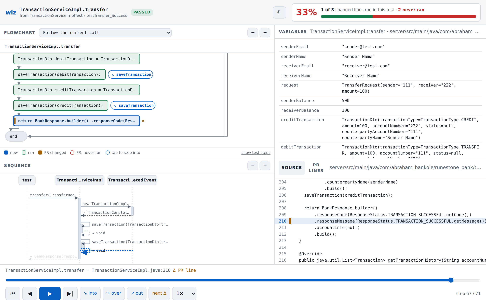

# Java (Maven and Gradle)

Needs a JDK 17+ (`javac` on PATH, `$JAVA_HOME` or `--java-home`) and the
project's Maven or Gradle (wrappers `mvnw`/`gradlew` are preferred).

## How a test is run

- Tests are found by reading the test sources for JUnit 4/5 annotations
  (`@Test`, `@ParameterizedTest`, `@RepeatedTest`, `@TestFactory`,
  `@TestTemplate`), so the list appears without a build.
- The build is found from the test file: the nearest `pom.xml` or
  `build.gradle(.kts)` is its module, the build root is above it (the
  `settings.gradle` or top `pom.xml`). Only that module's tests run
  (`-pl module -am` for Maven, `:module:test` for Gradle).
- It runs only that test, with `-agentlib:jdwp` added to the test JVM (Maven:
  `-Dmaven.surefire.debug`; Gradle: an init script, build scans off with
  `--no-scan`). The outcome comes from the JUnit XML report.
- Maven: the build root is the top `pom.xml` that lists the module (even
  with pom-less folders between, like `services/payments`), so `-pl -am`
  builds its sibling modules too.
- Gradle: the task is the test's source set (`src/test/java` → `test`,
  `src/integrationTest/java` → `integrationTest`).
- The first run lets Maven/Gradle download what the project needs, as a normal
  build would.

## Big builds and why a recording fails

wiz waits for as long as the build runs (configuring a large multi-project
build and compiling can take minutes) and shows the build's progress while it
records. The Gradle init script (`~/.cache/wizualizer/gradle/`) is built to
survive real builds:

- it adds the agent as a `jvmArgumentProvider`, so a build that **sets**
  `jvmArgs = [...]` on its Test tasks cannot drop it (with a plain `jvmArgs`
  call the test ran without the agent: "the test JVM never connected");
- it applies after the build's own scripts, to the main build only (not
  `buildSrc` or included builds), and stops the test task from being
  `UP-TO-DATE` or `FROM-CACHE`;
- the file never changes and the agent's address comes in as
  `-Dwiz.jdwp=...`, so the configuration cache is reused between recordings.

Once the test JVM connects, the test has **5 minutes** to finish (`--timeout
SECONDS` or `WIZ_RECORD_TIMEOUT`; `0` for no limit). After that wiz stops it
and says so in one line. Stopping, whether from the timeout, Ctrl+C, SIGTERM or
even `kill -9` of wiz, ends the test JVM over JDWP (a suspended JVM ignores
SIGTERM), then the build. A Gradle daemon goes back to idle instead of staying
busy, so the next recording does not start a second one.

If the build ends without the test JVM connecting, wiz says why in one line
(compile error, no matching test, test task skipped, build failure,
Docker missing, test JVM started without the agent) with a fix, and keeps the
whole build output in `.wiz/logs/`.

Settings, as environment variables when you start `wiz`:

| variable | what it does |
|---|---|
| `WIZ_GRADLE_ARGS` | extra Gradle arguments, e.g. `--no-configuration-cache` or `-Pprofile=local` |
| `WIZ_MAVEN_ARGS` | extra Maven arguments, e.g. `-Plocal` |
| `WIZ_GRADLE_TEST_TASK` | the Test task to run, when it is not named after the source set |

wiz records tests that run inside the JVM: an entry point (a controller or
handler called directly, MockMvc, WebTestClient bound to the app) down to
the exit and back, with external services mocked. Testcontainers is not a
goal: a test that uses it (or a superclass that does) is refused up front
when no Docker is reachable, instead of hanging.

## What gets recorded

Methods whose source is in the project. JDK, libraries, JUnit, Mockito mocks
and generated code (Lombok, record accessors, default constructors) get no
frame; the calls project code makes into them are listed with their arguments
and results, and a mocked call points at the project code it stood for
([mocked-calls.md](mocked-calls.md)). Lambdas are folded into the method that contains
them. Variables are the locals plus `this.<field>` for every field of `this`.
Objects from the project show their fields; JDK collections and maps their
items; `BigDecimal`, `BigInteger`, `java.time`, `UUID` and `URI` their value;
other library objects their class name. All of it is read from the objects'
fields: the recorder never runs a method in the test JVM. (Calling one on a
thread stopped at a debugger event could deadlock: the call can hit the
recorder's own breakpoints, or wait on a lock the stopped thread holds.)

## The helper

A small Java program in `src/wizualizer/java/helper/` does the JVM side (the
JDI recorder, the change probe, and javac's own parser for statements and
flowcharts). It uses only what every JDK ships (`jdk.jdi`, `jdk.compiler`) and
is compiled once per JDK into `~/.cache/wizualizer/java-helper/`.

## Example: RuneStone-Bank

Tried on [RuneStone-Bank](https://github.com/Semilore317/RuneStone-Bank), a
Spring Boot app with Gradle in `server/` (not part of this repo). At commit
`fde9dbc` with `--base fde9dbc^`, `wiz` finds 37 Java tests (its Kotlin tests
are skipped); only-changes lists two:
`TransactionServiceImplTest#testTransfer_Success` (91 steps, about 7 s to
record; 1 of the 3 changed lines ran) and `#testCreditAccount_Success` (2 of 3).

## Limits

- Only the test method runs under the recorder (`@BeforeEach` and the test
  class constructor are not recorded), and only on the test's thread.
- Kotlin, Scala and Groovy code is not recorded, nor classes in the default
  package. Classes need debug info (`-g`, Maven and Gradle's default).
- Surefire `forkCount=0` (tests inside Maven's JVM) is not supported.
- Code the test hands to another thread (a real HTTP server with
  `webEnvironment = RANDOM_PORT`, `@Async`, reactive schedulers) is not
  recorded; MockMvc and direct calls run on the test's thread.
- Recording puts breakpoints on every project line plus method entry/exit, so
  a test runs several times slower than normal.
